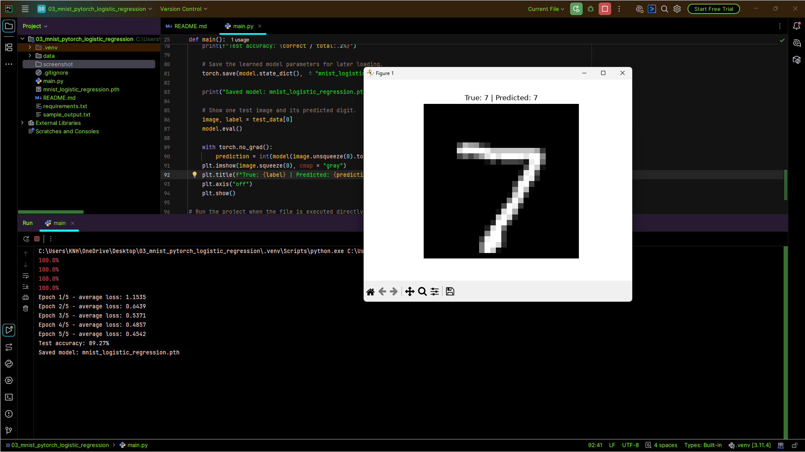

# PyTorch Logistic Regression for MNIST

A compact PyTorch project that classifies handwritten digits using a **single linear layer**. Despite the name “logistic regression,” the implementation handles ten classes with a linear layer that outputs ten raw class scores, also known as logits. It is a useful baseline for understanding the PyTorch training loop before moving to deeper networks.

## Project Goals

- Load and batch a standard image dataset with Torchvision.
- Convert image pixels to tensors.
- Flatten a 28 × 28 image into 784 input features.
- Implement a model by subclassing `torch.nn.Module`.
- Train with `CrossEntropyLoss`, backpropagation, and SGD.
- Evaluate the model in inference mode without gradient calculation.
- Select a CPU or CUDA device automatically when available.
- Save the learned model parameters.

## Technology Stack

- **PyTorch** — model, automatic differentiation, loss, optimizer, and device selection
- **Torchvision** — MNIST dataset and tensor transforms
- **Matplotlib** — display a test image with its true and predicted digit

## Dataset: MNIST

The script uses `torchvision.datasets.MNIST` and downloads the dataset when it is not already present in the local `data/` directory. MNIST consists of 28 × 28 grayscale digit images with labels 0–9. No custom CSV is required.

## Model Architecture

The `LogisticRegression` class contains one linear transformation:

- **Input:** 784 pixel values per image
- **Output:** 10 logits, one score for each digit class
- **Prediction:** The class with the highest logit is selected using `argmax`

This model is deliberately linear. It does not include hidden dense layers, convolutional layers, embeddings, or attention.

### Important Loss-Function Detail

The script passes the model's raw logits to `nn.CrossEntropyLoss`. This is correct: PyTorch's cross-entropy loss incorporates the log-softmax operation internally. Do not add a softmax layer before the loss in this training setup.

## Training Configuration

| Setting | Value |
|---|---|
| Optimizer | Stochastic Gradient Descent (`SGD`) |
| Learning rate | `0.01` |
| Loss function | `CrossEntropyLoss` |
| Epochs | 5 |
| Batch size | 100 |
| Input transform | `ToTensor()` |
| Device | CUDA when available; otherwise CPU |

During training, the script clears old gradients, calculates logits and loss, backpropagates the loss, and updates the linear-layer parameters. It prints the average training loss after each epoch.

## Workflow

1. Select the available computation device.
2. Load MNIST through Torchvision.
3. Convert images to tensors with pixel values scaled into the `0–1` range.
4. Create data loaders for training and testing.
5. Instantiate the linear model, loss function, and SGD optimizer.
6. Train for five epochs.
7. Switch the model to evaluation mode and calculate test accuracy without gradients.
8. Save the model's state dictionary to `mnist_logistic_regression.pth`.
9. Display one test image with its true and predicted labels.

## Output and Artifacts

The console displays average training loss for each epoch, final test accuracy, and a model-save confirmation. Matplotlib displays one example test image.

The main saved artifact is `mnist_logistic_regression.pth`, which contains the learned **state dictionary** rather than a complete serialized model object. To reload it later, recreate the same `LogisticRegression` class and load the saved state dictionary.

The reported test accuracy is produced by your run and may vary. Because this is a linear baseline, it is not expected to represent the strongest possible MNIST model.

## Installation and Execution

```powershell
python -m venv .venv
.\.venv\Scripts\Activate.ps1
python -m pip install -r requirements.txt
python main.py
```

If PyTorch installation fails, select an installation command compatible with your Python version and operating system using the official PyTorch installation guidance. CPU execution is supported; a CUDA-capable GPU is optional.

## Project Files

| File / Folder                   | Purpose                                                                                         |
|---------------------------------|-------------------------------------------------------------------------------------------------|
| `main.py`                       | Defines the linear model and runs training, test evaluation, plotting, and saving.              |
| `requirements.txt`              | Lists PyTorch, Torchvision, and Matplotlib dependencies.                                        |
| `data/`                         | Local MNIST cache created by Torchvision.                                                       |
| `screenshot/output.png`         | Screenshot of actual terminal result or displayed prediction. |
| `mnist_logistic_regression.pth` | Generated model state dictionary.                                                               |

## Output Screenshot



*The image is expected at `screenshot/output.png` relative to this README.*

## Limitations

- A single linear layer cannot learn complex nonlinear image features.
- The script reports overall test accuracy but does not calculate a per-digit classification report or confusion matrix.
- The saved state dictionary requires the matching model definition to be recreated before loading.
- MNIST results may not transfer to handwritten digits captured with different backgrounds, sizes, or camera conditions.

## Possible Next Steps

- Add a confusion matrix to study which digits are often confused.
- Compare the linear classifier with the TensorFlow dense model and a CNN.
- Add a small prediction function that accepts a new 28 × 28 grayscale image.

**Project level:** Junior · PyTorch · Supervised Learning · Linear Classification

# Moe Htet Ar Kar (Phoe Cho)
